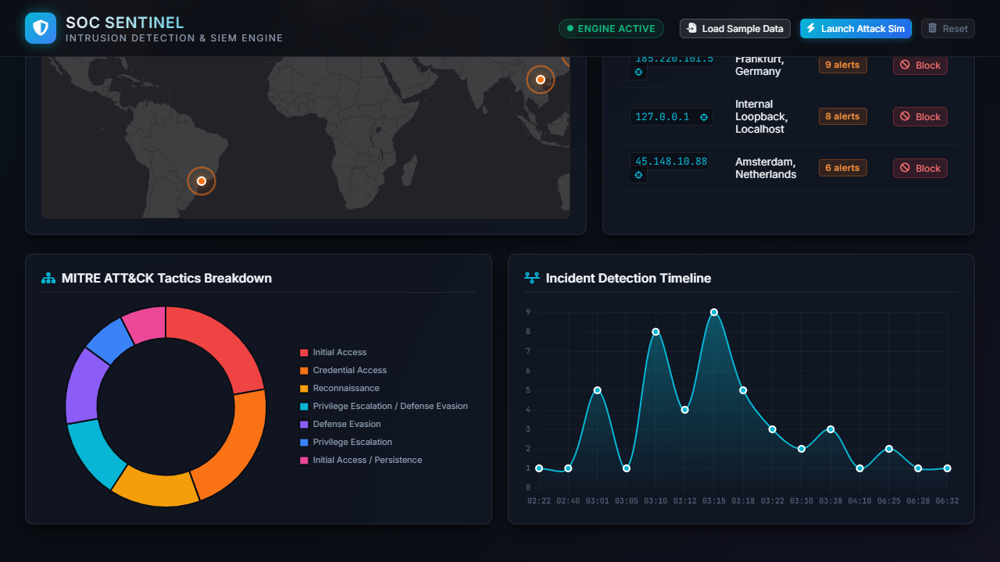
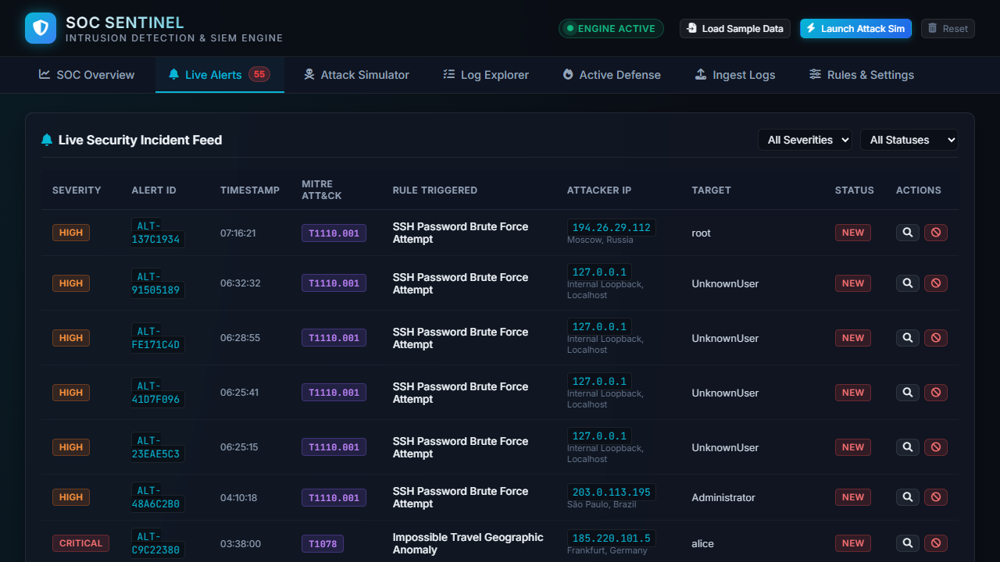
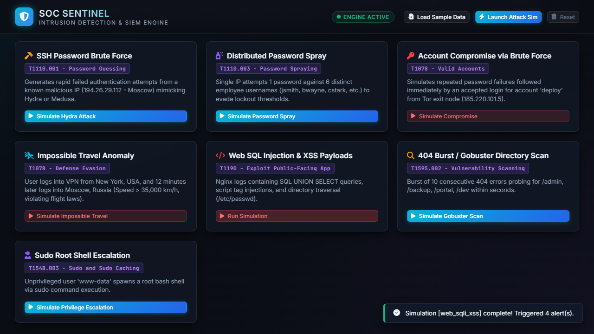
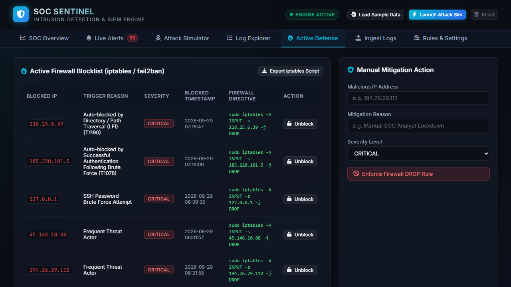
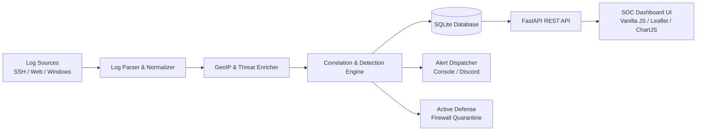

# 🛡️ SOC Sentinel — Intrusion Detection & SIEM Log Analysis System

> **A Next-Gen Security Operations Center (SOC) Log Analysis and Intrusion Detection Platform featuring real-time MITRE ATT&CK correlation, GeoIP threat intelligence, attack simulation, and automated active defense.**

---

## 🌟 Key Features

- **⚡ Multi-Source Ingestion & Normalization**: Native parsers for Linux SSH (`auth.log`), Web Servers (Nginx/Apache access logs), and Windows Security Event Logs (Event IDs 4624, 4625, 4672, etc.).
- **🎯 MITRE ATT&CK Correlation Engine**: Real-time detection against tactics including Credential Access (T1110), Initial Access (T1078, T1190), Defense Evasion, and Privilege Escalation.
- **🌍 Global GeoIP Threat Telemetry**: Interactive Leaflet threat map visualizing attacker geographical coordinates, ASN, and country origins.
- **🚀 Built-in Attack Vector Simulator**: Instant one-click simulations for Hydra SSH brute-force, Distributed Password Spraying, Web SQLi / XSS probes, and Impossible Travel anomalies.
- **🔥 Active Defense & Automated Containment**: Dynamic firewall blocklist with automated `iptables` and `fail2ban` directive generation.
- **📊 Real-Time SOC Analyst Triage**: Incident feed with severity badges (`CRITICAL`, `HIGH`, `MEDIUM`), MITRE technique tags, and status workflows (`NEW`, `INVESTIGATING`, `RESOLVED`, `FALSE_POSITIVE`).

---

## 📸 Preview & Screenshots

| SOC Overview & Threat Telemetry | Real-Time Incident Alerts Feed |
|:---:|:---:|
|  |  |

| Attack Vector Simulator | Active Defense / Firewall |
|:---:|:---:|
|  |  |

---

## 🛠️ Architecture & Tech Stack



- **Backend**: Python 3.10+, FastAPI, Uvicorn, Pydantic, PyYAML
- **Database**: SQLite (Zero configuration, thread-safe WAL mode)
- **Frontend**: Vanilla HTML5/CSS3/JavaScript (Dark SOC Glassmorphism theme, Leaflet.js, Chart.js, FontAwesome)

---

## 🚀 Quickstart Guide

### 1. Clone & Set Up Virtual Environment

```bash
git clone https://github.com/your-username/soc-sentinel.git
cd soc-sentinel

# Create and activate virtual environment
python -m venv .venv

# Windows:
.\.venv\Scripts\activate
# Linux/macOS:
source .venv/bin/activate

# Install dependencies
pip install -r requirements.txt
```

### 2. Launch the Application

```bash
python server.py
```

Open your browser at **`http://127.0.0.1:8000`** to access the SOC Sentinel Dashboard.

### 3. Quick Demonstration

1. Click **"Load Sample Data"** in the top header to populate realistic attack logs.
2. Click **"Launch Attack Sim"** to simulate an active Hydra SSH brute-force attack.
3. Explore the **Live Alerts**, **Attack Simulator**, and **Active Defense** tabs!

---

## 📁 Repository Structure

```
├── config/              # Detection rules configuration (rules.yaml)
├── core/                # Core engine, database, models, simulator & enricher
├── parsers/             # Multi-source log parsers (SSH, Web, Windows)
├── samples/             # RFC-compliant sample attack log datasets
├── static/              # Dashboard frontend (HTML, CSS, JS, charts)
├── tests/               # Test suite
├── demo_screenshots/   # Visual documentation screenshots
├── server.py            # FastAPI application server entrypoint
├── requirements.txt     # Python dependencies
└── README.md            # Documentation
```

---

## ⚖️ License & Ethical Use

This software is designed solely for educational, defensive security analysis, and SOC portfolio demonstration purposes.
